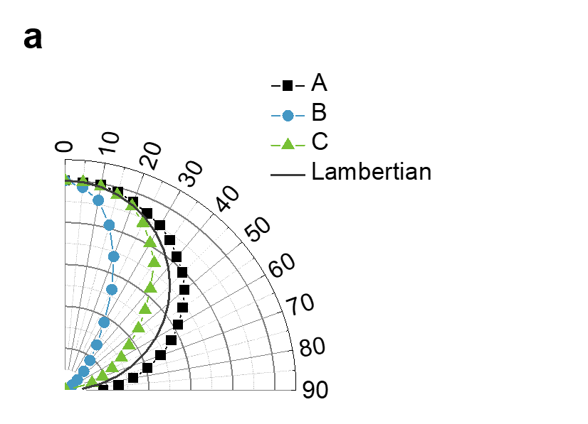
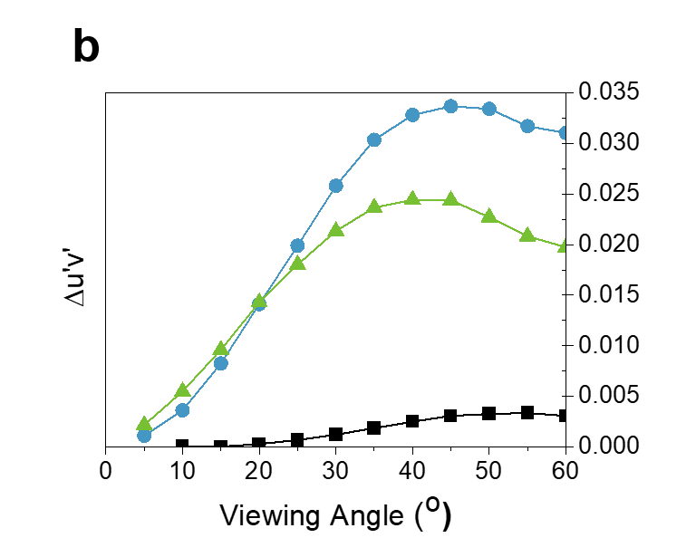

# OLED 실험 9주차 — Microcavity OLED 소자의 광손실 및 시야각 특성 확인

**작성자:** 이영빈 **학번:** 2023101942

> 측정 소자: A (Non-microcavity), B (Microcavity), C (광추출 구조가 적용된 Microcavity) 
> 측정: ADEL(Angle-Dependent EL) 장비로 각도별 EL 스펙트럼, Lambertian pattern, 색좌표 변화(Δu′v′) 측정

---

## Ⅰ. 실험 목적

- OLED 소자에서 빛이 손실되는 경로(substrate, waveguide, surface plasmon)를 이해하고 각 경로의 광추출 방법을 정리한다.
- Microcavity 소자와 non-microcavity 소자의 시야각 특성을 Lambertian pattern과 색좌표 변화로 비교한다.
- 광추출 구조가 microcavity 소자의 시야각 특성을 어떻게 개선하는지 확인한다.

---

## Ⅱ. 실험 원리

### A. Microcavity와 Fabry-Perot 공진

Fabry-Perot 간섭계는 평행한 두 반사면 사이에서 빛이 반사와 투과를 반복하며 간섭을 일으키는 구조이다. 투과광의 세기는 다음과 같다.

> I = I0 / [1 + F sin2(δ/2)],  F = 4R / (1 − R)2 
> δ = (4π / λ) · n d cos θin

I0는 입사광의 세기, R은 반사계수, δ는 두 반사면 사이를 왕복하는 동안의 위상 변화, n과 d는 내부 매질의 굴절률과 두께, θin은 내부 진행 각도이다. δ가 2π의 정수배일 때 투과가 최대가 되므로 공진 조건은 다음과 같다.

> 2 n d cos θin = m λ  (m = 1, 2, …)

전면 발광 OLED는 반사 전극(anode)과 반투과 전극(Mg:Ag cathode) 사이에 유기층이 있어 microcavity를 이룬다. 공진 파장의 빛은 강해지고 스펙트럼 폭이 좁아져 정면 효율과 색순도가 높아진다. 그러나 공진 파장이 cos θin에 비례하므로, 보는 각도가 커질수록 공진 파장이 짧아지는 blue shift가 일어난다.

### B. OLED의 광손실 경로

인광과 TADF 재료로 내부 양자효율은 100 %에 가까워졌지만, OLED는 굴절률이 다른 층이 쌓인 구조여서 내부에서 만들어진 빛의 약 80 %가 밖으로 나오지 못한다. 층 계면에서의 전반사 조건에 따라 빛은 다음 모드로 나뉜다. 여기서 k∥ = (2π/λ) n sin θ는 계면에 평행한 파수 성분이다.

| 모드 | 조건 | 갇히는 위치 |
|------|------|------|
| Air mode | k∥ < (2π/λ) nair | 외부로 방출 |
| Substrate mode | (2π/λ) nair < k∥ < (2π/λ) nglass | 유리 기판 |
| Waveguide (WG) mode | (2π/λ) nglass < k∥ < (2π/λ) nITO+organic | ITO와 유기층 |
| SPP mode | (2π/λ) nITO+organic < k∥ | 금속 전극 표면 |

SPP(surface plasmon polariton)는 발광 쌍극자의 근접장이 금속 표면의 전자 진동과 결합한 비발광 모드이다. 이 밖에 금속과 유기물의 흡수에 의한 손실도 있다.

### C. Lambertian 분포와 색좌표 변화

Lambertian 광원은 어느 방향에서 보아도 휘도가 같으며, 각도에 따른 광세기가 I(θ) = I0 cos θ를 따른다. 디스플레이는 이 분포에 가까울수록 시야각 특성이 좋다. 각도에 따른 색 변화는 CIE 1976 색좌표에서 정면 대비 거리로 나타낸다.

> Δu′v′ = √[(u′θ − u′0°)2 + (v′θ − v′0°)2]

---

## Ⅲ. 실험 방법

### A. 기구 및 재료

ITO 기판, Thermal evaporator, ADEL 측정 장비, Encapsulation 재료

### B. 실험 과정

1. Thermal evaporator로 microcavity OLED 소자를 증착한다.
2. Encapsulation을 진행한다.
3. 소자를 ADEL jig에 장착한다.
4. Single shot으로 EL 스펙트럼과 photon count를 확인한다(photon count 1.5–2만, polarizer 없음).
5. Start를 눌러 각도별 측정을 진행한다.

---

## Ⅳ. 실험 결과 및 고찰

Fig. 1–3은 조교가 제공한 측정 결과 그래프이다. Table 1의 수치는 그래프에서 읽은 값이며, 소자 A, B, C의 구조는 스펙트럼과 각도 특성으로 판단하였다.

### 1. OLED 전면, 후면 발광소자의 광 손실 경로를 설명하고 각 광손실 경로(WG / SPP)의 광추출 방법을 설명하시오.

**후면(배면) 발광 소자.** 빛은 투명한 ITO와 유리 기판을 지나 아래로 나오고, 위쪽 금속 cathode는 반사판 역할을 한다. 유리(n ≈ 1.5)와 공기(n = 1.0) 계면에서 전반사된 빛은 substrate mode로, ITO와 유기층(n ≈ 1.8–2.0)과 유리 계면에서 전반사된 빛은 waveguide mode로 갇힌다. 금속 cathode 가까이에서 생긴 빛의 일부는 SPP mode로 소멸한다. 매뉴얼의 그림 5에서 각 모드의 비율은 air 약 20 %, substrate 약 20 %, waveguide 약 15 %, SPP 약 40 %이다.

**전면 발광 소자.** 빛은 반투과 cathode를 지나 위로 나오므로 유리 기판을 거치지 않아 substrate mode가 없다. 대신 두 전극이 강한 microcavity를 이루어 정면 방향 빛은 최대 2배까지 강해지지만, 측면으로 진행하는 빛은 크게 손실된다. 매뉴얼에 따르면 waveguide 손실이 약 20 %, SPP와 유기물 흡수에 의한 손실이 약 60 %이며, 그중 SPP 손실이 약 50 %로 가장 크다.

**WG mode 광추출 방법.** WG mode는 고굴절 ITO·유기층 안에서 전반사로 갇힌 빛이므로, 진행 방향을 바꾸거나 전반사 조건을 깨는 구조를 넣는다.

- Microlens array(MLA): 소자 표면에 반구형 렌즈를 배열해 계면 입사각을 임계각보다 작게 만들어 빛을 꺼낸다.
- 산란층: 고굴절 나노입자나 기공을 포함한 층을 ITO 아래에 넣어 갇힌 빛을 여러 방향으로 산란시킨다.
- 주기 구조: 회절격자나 photonic crystal로 k∥를 바꾸어 빛을 air mode로 회절시킨다.
- 굴절률 조절: 고굴절 기판을 쓰거나, 유기층 안에 저굴절 grid를 넣어 전반사 조건을 바꾼다.
- 전면 발광 소자에서는 cathode 위에 고굴절 capping layer(CPL)를 올려 계면 반사와 공진 조건을 조절한다.

**SPP mode 광추출 방법.** SPP는 발광 위치와 금속 사이의 거리, 발광 쌍극자의 방향, 금속 표면 상태에 따라 결정된다.

- 발광층과 금속 사이의 거리 증가: ETL을 두껍게 하면 근접장 결합이 약해져 SPP 손실이 줄어든다.
- 수평 배향 발광체: 쌍극자가 기판과 평행하게 놓이면 SPP와 잘 결합하지 않는다.
- 금속 표면 주름 구조: 금속 계면에 주기적 요철을 만들면 SPP 에너지를 빛으로 다시 방출(Bragg 산란)시킬 수 있다.
- 공진 구조 설계: 매뉴얼 그림 2, 3처럼 microcavity의 Purcell 효과를 이용해 원하는 방향의 방출을 키우고 SPP로 가는 비율을 줄인다.

### 2. Microcavity Device와 Non Microcavity Device의 시야각 의존성을 Lambertian Pattern 및 색좌표 변동성 그래프를 통해 구분하고 근거를 설명하시오.

**Fig. 1** A, B, C와 Lambertian의 각도별 광세기 분포

**Fig. 2** 각도에 따른 색좌표 변화 Δu′v′

**Fig. 3** 정면 EL 스펙트럼 (검정 A, 파랑 B, 초록 C)

**Table 1** 소자별 시야각 특성 (0° 세기로 정규화)

| 항목 | Lambertian | A | B | C |
|------|------|------|------|------|
| EL 최대 파장 | – | 520 nm | 532 nm | 532 nm |
| EL 반치폭(FWHM) | – | 72 nm | 27 nm | 30 nm |
| I(30°) | 0.87 | 0.91 | 0.37 | 0.81 |
| I(60°) | 0.50 | 0.62 | 0.03 | 0.31 |
| 세기가 절반이 되는 각도 | 60° | 69° | 26° | 48° |
| 최대 Δu′v′ (0–60°) | – | 0.0034 | 0.0337 | 0.0244 |

**Non-microcavity 소자(A).** A는 EL 반치폭이 72 nm로 넓고 550 nm 부근에 shoulder가 있어, 발광 재료 고유의 스펙트럼이 공진의 영향 없이 나온 것으로 볼 수 있다. 각도 분포는 Lambertian 곡선과 거의 겹치거나 약간 바깥에 있다. 60°에서 세기가 0.62로 Lambertian(0.50)보다 크고, 세기가 절반이 되는 각도도 69°로 Lambertian(60°)보다 넓다. Δu′v′는 60°까지 최대 0.0034로 매우 작아 각도에 따른 색 변화가 거의 없다. 공진 조건이 약하면 방출 스펙트럼이 각도에 따라 달라지지 않기 때문이다.

**Microcavity 소자(B).** B는 반치폭이 27 nm로 A의 약 1/3이다. 두 전극 사이의 공진으로 공진 파장(532 nm) 근처의 빛만 강해졌기 때문이다. 각도 분포는 Lambertian 곡선보다 크게 안쪽에 있다. 30°에서 세기가 0.37, 60°에서 0.03으로 떨어지고, 세기가 절반이 되는 각도는 26°이다. 즉 빛이 정면에 집중된다. Δu′v′는 각도에 따라 빠르게 커져 30°에서 0.026, 45°에서 최대 0.034에 이르며, A의 약 10배이다. 공진 조건 2nd cos θin = mλ에서 각도가 커지면 공진 파장이 짧아지므로, 측면에서는 스펙트럼이 단파장 쪽으로 이동해 색이 달라진다. 이것이 매뉴얼에서 말한 측면 bluish 현상의 원인이다.

**구분 근거.** 두 소자는 다음 세 가지로 구분된다. 첫째, 스펙트럼 폭이 B에서 크게 좁다. 둘째, Lambertian pattern에서 A는 cos θ에 가깝거나 더 넓고, B는 정면에 집중된다. 셋째, Δu′v′가 A는 0.004 이하로 거의 일정하지만 B는 0.034까지 커진다. 세 결과 모두 B가 강한 microcavity 소자임을 보여준다.

### 3. 광추출 구조가 적용된 Microcavity Device와 적용되지 않은 Microcavity Device를 Lambertian Pattern 및 색좌표 변동성 그래프를 통해 구분하고 근거를 설명하시오.

B와 C는 정면 스펙트럼이 거의 같다(최대 532 nm, 반치폭 27 nm와 30 nm). 따라서 두 소자는 같은 microcavity 구조를 갖고, C에만 광추출 구조가 더해진 것으로 판단할 수 있다.

**Lambertian pattern.** C의 각도 분포는 B보다 훨씬 넓어 Lambertian 곡선에 가까워졌다. 30°에서 세기는 B 0.37에서 C 0.81로, 60°에서는 0.03에서 0.31로 커졌다. 세기가 절반이 되는 각도도 26°에서 48°로 넓어졌다. 0° 세기를 같게 놓고 전체 방향으로 적분한 광량은 Lambertian 대비 B가 0.28, C가 0.77로 약 2.8배이다. 광추출 구조가 정면으로 나오지 못하고 측면이나 소자 안에 갇혀 있던 빛을 여러 방향으로 산란시켜 꺼냈기 때문이다.

**색좌표 변화.** C의 최대 Δu′v′는 0.0244(40–45°)로 B의 0.0337보다 28 % 작고, 60°에서는 B 0.031, C 0.020으로 36 % 작다. 20° 이하에서는 두 소자가 거의 같지만 각도가 커질수록 차이가 벌어진다. 광추출 구조가 산란으로 여러 각도의 빛을 섞으면, 측면에서도 정면 방향의 공진 파장 빛이 함께 나와 blue shift가 상쇄된다. 그래서 큰 각도에서 색 변화가 줄어든다.

**구분 근거.** C는 B와 정면 스펙트럼이 같으면서 Lambertian pattern은 cos θ에 가까워지고 Δu′v′는 작아졌다. 이는 광추출 구조가 microcavity의 정면 집중과 각도별 색 변화를 함께 완화했음을 보여준다. 다만 C도 A보다는 각도 분포가 좁고 Δu′v′가 약 7배 커서, 광추출 구조만으로 microcavity의 시야각 의존성을 완전히 없애지는 못하였다.

---

### 참고문헌

1. R. Meerheim, M. Furno, S. Hofmann, B. Lüssem, K. Leo, "Quantification of energy loss mechanisms in organic light-emitting diodes," *Appl. Phys. Lett.* **97**, 253305 (2010).

### 부록 — 데이터 처리

- Fig. 1–3은 조교가 제공한 결과 파일(`2026 OLED 실험_9주차 ADEL_실험 결과.pptx`)의 그래프를 그대로 사용하였다.
- Table 1의 값과 본문의 수치는 그래프 눈금에서 읽은 값이다. 세기가 절반이 되는 각도와 적분 광량은 읽은 점을 선형 보간하여 구하였고, 적분 광량은 ∫ I(θ) sin θ dθ를 Lambertian의 값(0.5)으로 나눈 상대값이다.
