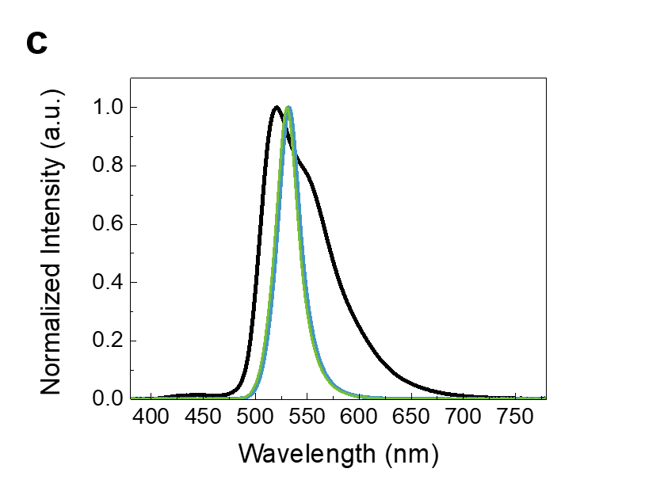

# OLED 실험 9주차 — Microcavity OLED 소자의 광손실 및 시야각 특성 확인

**작성자:** 이영빈 **학번:** 2023101942

> 측정 소자: A (Non-microcavity), B (Microcavity), C (광추출 구조가 적용된 Microcavity) 
> 측정: ADEL(Angle-Dependent EL) 장비로 각도별 EL 스펙트럼, Lambertian pattern, 색좌표 변화(Δu′v′) 측정

---

## Ⅰ. 실험 목적

- OLED 소자에서 빛이 손실되는 경로(substrate, waveguide, surface plasmon)를 이해하고 각 경로의 광추출 방법을 정리한다.
- Microcavity 소자와 non-microcavity 소자의 시야각 특성을 Lambertian pattern과 색좌표 변화로 비교한다.
- 광추출 구조가 microcavity 소자의 시야각 특성을 어떻게 개선하는지 확인한다.

---

## Ⅱ. 실험 원리

### A. Microcavity와 Fabry-Perot 공진

Fabry-Perot 간섭계는 평행한 두 반사면 사이에서 빛이 반사와 투과를 반복하며 간섭을 일으키는 구조이다. 투과광의 세기는 다음과 같다.

> I = I0 / [1 + F sin2(δ/2)],  F = 4R / (1 − R)2 
> δ = (4π / λ) · n d cos θin

I0는 입사광의 세기, R은 반사계수, δ는 두 반사면 사이를 왕복하는 동안의 위상 변화, n과 d는 내부 매질의 굴절률과 두께, θin은 내부 진행 각도이다. δ가 2π의 정수배일 때 투과가 최대가 되므로 공진 조건은 다음과 같다.

> 2 n d cos θin = m λ  (m = 1, 2, …)

전면 발광 OLED는 반사 전극(anode)과 반투과 전극(Mg:Ag cathode) 사이에 유기층이 있어 microcavity를 이룬다. 공진 파장의 빛은 강해지고 스펙트럼 폭이 좁아져 정면 효율과 색순도가 높아진다. 그러나 공진 파장이 cos θin에 비례하므로, 보는 각도가 커질수록 공진 파장이 짧아지는 blue shift가 일어난다.

### B. OLED의 광손실 경로

인광과 TADF 재료로 내부 양자효율은 100 %에 가까워졌지만, OLED는 굴절률이 다른 층이 쌓인 구조여서 내부에서 만들어진 빛의 약 80 %가 밖으로 나오지 못한다. 층 계면에서의 전반사 조건에 따라 빛은 다음 모드로 나뉜다. 여기서 k∥ = (2π/λ) n sin θ는 계면에 평행한 파수 성분이다.

| 모드 | 조건 | 갇히는 위치 |
|------|------|------|
| Air mode | k∥ < (2π/λ) nair | 외부로 방출 |
| Substrate mode | (2π/λ) nair < k∥ < (2π/λ) nglass | 유리 기판 |
| Waveguide (WG) mode | (2π/λ) nglass < k∥ < (2π/λ) nITO+organic | ITO와 유기층 |
| SPP mode | (2π/λ) nITO+organic < k∥ | 금속 전극 표면 |

SPP(surface plasmon polariton)는 발광 쌍극자의 근접장이 금속 표면의 전자 진동과 결합한 비발광 모드이다. 이 밖에 금속과 유기물의 흡수에 의한 손실도 있다.

### C. Lambertian 분포와 색좌표 변화

Lambertian 광원은 어느 방향에서 보아도 휘도가 같으며, 각도에 따른 광세기가 I(θ) = I0 cos θ를 따른다. 디스플레이는 이 분포에 가까울수록 시야각 특성이 좋다. 각도에 따른 색 변화는 CIE 1976 색좌표에서 정면 대비 거리로 나타낸다.

> Δu′v′ = √[(u′θ − u′0°)2 + (v′θ − v′0°)2]

---

## Ⅲ. 실험 방법

### A. 기구 및 재료

ITO 기판, Thermal evaporator, ADEL 측정 장비, Encapsulation 재료

### B. 실험 과정

1. Thermal evaporator로 microcavity OLED 소자를 증착한다.
2. Encapsulation을 진행한다.
3. 소자를 ADEL jig에 장착한다.
4. Single shot으로 EL 스펙트럼과 photon count를 확인한다(photon count 1.5–2만, polarizer 없음).
5. Start를 눌러 각도별 측정을 진행한다.

---

## Ⅳ. 실험 결과 및 고찰

Fig. 1–3은 조교가 제공한 측정 결과 그래프이다. Table 1의 수치는 그래프에서 읽은 값이며, 소자 A, B, C의 구조는 스펙트럼과 각도 특성으로 판단하였다.

### 1. OLED 전면, 후면 발광소자의 광 손실 경로를 설명하고 각 광손실 경로(WG / SPP)의 광추출 방법을 설명하시오.

**후면 발광 소자.** 빛이 ITO와 유리 기판을 지나 아래로 나오고, 금속 cathode는 반사판 역할을 한다. 유리와 공기 계면에서 전반사된 빛은 substrate mode, ITO·유기층과 유리 계면에서 전반사된 빛은 WG mode로 갇히며, cathode 근처의 빛 일부는 SPP mode로 소멸한다. 매뉴얼 기준 비율은 air 약 20 %, substrate 약 20 %, WG 약 15 %, SPP 약 40 %이다.

**전면 발광 소자.** 빛이 반투과 cathode를 지나 위로 나오므로 substrate mode가 없다. 두 전극이 강한 microcavity를 이루어 정면 빛은 최대 2배까지 강해지지만 측면 빛은 크게 손실된다. WG 손실이 약 20 %, SPP와 흡수 손실이 약 60 %(그중 SPP 약 50 %)이다.

**WG mode 광추출 방법.** 고굴절층 안에 전반사로 갇힌 빛의 진행 방향을 바꾼다.

- Microlens array(MLA): 표면의 반구형 렌즈가 계면 입사각을 임계각보다 작게 만든다.
- 산란층: 나노입자나 기공을 넣은 층이 갇힌 빛을 여러 방향으로 산란시킨다.
- 회절격자, photonic crystal: k∥를 바꾸어 빛을 air mode로 회절시킨다.

**SPP mode 광추출 방법.**

- 발광층과 금속 사이 거리 증가: ETL을 두껍게 해 근접장 결합을 줄인다.
- 수평 배향 발광체: 기판과 평행한 쌍극자는 SPP와 잘 결합하지 않는다.
- 금속 표면 주름 구조: 주기적 요철이 SPP를 빛으로 다시 방출(Bragg 산란)시킨다.

### 2. Microcavity Device와 Non Microcavity Device의 시야각 의존성을 Lambertian Pattern 및 색좌표 변동성 그래프를 통해 구분하고 근거를 설명하시오.

**Fig. 1** A, B, C와 Lambertian의 각도별 광세기 분포

**Fig. 2** 각도에 따른 색좌표 변화 Δu′v′

**Fig. 3** 정면 EL 스펙트럼 (검정 A, 파랑 B, 초록 C)

**Table 1** 소자별 시야각 특성 (0° 세기로 정규화)

| 항목 | Lambertian | A | B | C |
|------|------|------|------|------|
| EL 최대 파장 | – | 520 nm | 532 nm | 532 nm |
| EL 반치폭(FWHM) | – | 72 nm | 27 nm | 30 nm |
| I(30°) | 0.87 | 0.91 | 0.37 | 0.81 |
| I(60°) | 0.50 | 0.62 | 0.03 | 0.31 |
| 세기가 절반이 되는 각도 | 60° | 69° | 26° | 48° |
| 최대 Δu′v′ (0–60°) | – | 0.0034 | 0.0337 | 0.0244 |

**Non-microcavity 소자(A).** 반치폭이 72 nm로 넓고 550 nm 부근에 shoulder가 있어, 발광 재료 고유의 스펙트럼이 그대로 나온다. 각도 분포는 Lambertian과 거의 겹치며(60°에서 A 0.62, Lambertian 0.50), Δu′v′는 60°까지 최대 0.0034로 색 변화가 거의 없다.

**Microcavity 소자(B).** 반치폭이 27 nm로 A의 약 1/3이다. 공진으로 532 nm 근처의 빛만 강해졌기 때문이다. 세기는 30°에서 0.37, 60°에서 0.03으로 떨어져 빛이 정면에 집중된다. Δu′v′는 45°에서 최대 0.034로 A의 약 10배이다. 공진 조건 2nd cos θin = mλ에서 각도가 커지면 공진 파장이 짧아지므로, 측면에서 색이 단파장 쪽으로 바뀐다.

**구분 근거.** B는 A보다 스펙트럼이 좁고, Lambertian보다 빛이 정면에 집중되며, Δu′v′가 각도에 따라 크게 증가한다. 따라서 A는 non-microcavity, B는 microcavity 소자이다.

### 3. 광추출 구조가 적용된 Microcavity Device와 적용되지 않은 Microcavity Device를 Lambertian Pattern 및 색좌표 변동성 그래프를 통해 구분하고 근거를 설명하시오.

B와 C는 정면 스펙트럼이 같다(532 nm, 반치폭 27 nm와 30 nm). 따라서 같은 microcavity 구조에 C만 광추출 구조가 더해진 것으로 볼 수 있다.

**Lambertian pattern.** C는 B보다 분포가 넓어 Lambertian에 가깝다. 세기가 절반이 되는 각도가 26°에서 48°로 넓어졌고, 전체 방향으로 적분한 광량은 Lambertian 대비 B 0.28, C 0.77로 약 2.8배이다. 광추출 구조가 소자 안에 갇힌 빛을 여러 방향으로 꺼냈기 때문이다.

**색좌표 변화.** 최대 Δu′v′는 B 0.034, C 0.024로 C가 28 % 작다. 20° 이하에서는 비슷하지만 각도가 커질수록 차이가 벌어진다. 산란으로 여러 각도의 빛이 섞여 측면에서도 공진 파장의 빛이 함께 나오므로 blue shift가 줄어든다.

**구분 근거.** 정면 스펙트럼이 같으면서 Lambertian 분포가 넓고 Δu′v′가 작은 C가 광추출 구조가 적용된 소자이다. 다만 C도 A보다 Δu′v′가 약 7배 커서, 시야각 의존성이 완전히 없어지지는 않았다.

---

### 참고문헌

1. R. Meerheim, M. Furno, S. Hofmann, B. Lüssem, K. Leo, "Quantification of energy loss mechanisms in organic light-emitting diodes," *Appl. Phys. Lett.* **97**, 253305 (2010).

### 부록 — 데이터 처리

Fig. 1–3은 조교 제공 그래프를 그대로 사용하였고, 수치는 그래프 눈금에서 읽었다. 적분 광량은 ∫ I(θ) sin θ dθ를 Lambertian 값(0.5)으로 나눈 상대값이다.
